# Mutant Review

**100% coverage. 0 bugs caught.** Coverage tells you which lines ran, not whether any test would notice them breaking.

Mutant Review is a GitLab Duo agent that mutation-tests **only the lines a merge request changes**, shows the reviewer at most three changes no test would notice, drafts a test for each, and **proves every AI-drafted test by running it against the mutant before a human ever sees it**. A human replies `@mutant-review apply 1 and 3`; the agent commits those tests, re-runs the mutants, and teaches the repository's `AGENTS.md` so the next agent doesn't write the same useless test.

It also catches the move coverage can't see at all: **an MR that edits the tests instead of the code.** Loosen `toBe(0)` to `toBeLessThanOrEqual(500)`, delete the test that went red, and every line is still covered and every check still green. Mutant Review re-runs the target branch's mutants against the MR's tests and blocks the merge when one that used to be caught no longer is, naming the test that used to catch it.

The same engine runs **before the push** as an MCP server, so GitLab Duo Agentic Chat (or Claude Code, Cursor) can check its own tests against their mutants before an MR exists, and every review **measures its own carbon footprint** (SCI, ISO/IEC 21031) from real CPU time.

[](https://gitlab.com/mutant-review1/mutant-review/-/pipelines) [](LICENSE)

[GitLab project](https://gitlab.com/mutant-review1/mutant-review) · [Demo MR !1](https://gitlab.com/mutant-review1/mutant-review/-/merge_requests/1) · [Pipelines](https://gitlab.com/mutant-review1/mutant-review/-/pipelines) · [Benchmark](benchmarks/RESULTS.md) · [3-minute demo script](docs/demo.md)


### Judging in 60 seconds

1. **The gap:** [MR !1](https://gitlab.com/mutant-review1/mutant-review/-/merge_requests/1) has 100% branch coverage and green tests, and its [mutation gate](https://gitlab.com/mutant-review1/mutant-review/-/jobs/17440386477) still blocks the merge: `>=` can become `>` without a single test failing.
2. **The proof it matters:** in 11 of the last 25 merged PRs of es-toolkit, a library that advertises 100% coverage, a changed line could break unnoticed ([RESULTS.md](benchmarks/RESULTS.md)).
3. **The agent:** [`.gitlab/duo/mutant-review.yml`](.gitlab/duo/mutant-review.yml) is one deterministic step, one model call and one more deterministic step. Every AI-drafted test is run against its mutant before a human sees it.
4. **Try the core claim:** `npm ci && npm run test:e2e` keeps the real boundary test, rejects a plausible but useless one, then applies the approved test and moves the score from 80% to 100%. It also drives the MCP server over stdio: an uncommitted edit is mutation-checked and an agent's draft test is verified before any push.
5. **The agent that edits the tests:** the same e2e run builds real git repositories where an MR only loosens one assertion. Before, the gate had nothing to mutate and let it through with a warning. Now it fails: *"`ships for free above the threshold` failed on the target branch when the free-shipping condition became `false`; after this MR no test does"*, with the before/after assertion. A rename-only test refactor still passes ([how it works](#when-the-agent-edits-the-tests)).
6. **What it costs:** every review writes an SCI receipt (`17 mgCO2e` for the demo review, measured CPU time) to the MR comment, the MR metrics widget and Front Desk's Footprint page. Method: [docs/sustainability.md](docs/sustainability.md).

---

## The problem

When an agent writes both the code and the tests, the tests tend to mirror the implementation or assert on mocks. They stay green forever and protect nothing. Human review won't catch it either: on teams with high AI adoption, [PR review time rose 91%](https://www.faros.ai/research/ai-productivity-paradox) while merged PRs nearly doubled.

Google solved a version of this years ago: mutation-test only the changed lines during code review and surface the mutants that survive. Developers who saw them [wrote more tests and strengthened their suites](https://arxiv.org/abs/2103.07189). GitLab merge requests have nothing like it. Now they do.

There is a second failure that changed-line review alone can't see: the agent makes a red build green by changing the test. [ImpossibleBench](https://arxiv.org/abs/2510.20270) gave frontier coding agents SWE-bench tasks whose tests contradict the spec, so any pass is a cheat: GPT-5 "passed" 54% of them and Claude Opus 4.1 about half, and for Claude models more than 79% of those cheats modified the test cases. Read-only tests stopped the test edits in the benchmark, but an agent whose job includes writing tests can't work with read-only tests. So Mutant Review lets agents edit tests and checks, by execution, that the edit didn't remove protection.

## What the reviewer sees

An example of the summary comment `flow publish` writes, for the demo MR's measured result (`@mutant-review` stands for the flow's service account, `@ai-mutant-review-evidence-triage-mutant-review` in the demo project):

```text
Mutant Review: 1 change on your changed lines that no test would notice
Changed-line mutation score 75% (3 of 4 mutants killed). Policy 90%. Gate: failed.

| # | Where                    | Change no test noticed                          | Verified test                          |
| 1 | shipping.ts:4            | subtotalCents >= 10_000 → subtotalCents > 10_000 | ✅ ships free at exactly $100 kills it  |

1 AI-drafted test rejected by execution before you saw it. A test that still passes on the mutant protects nothing.
Reply `@mutant-review apply 1` to commit this verified test. Approving also adds "Untested boundary value" to AGENTS.md.
```

Inline on line 4: *"Changing `>=` to `>` fails no test. An order of exactly $100 is untested."* with the test that kills it.

And when an MR loosens that test later, the same comment leads with what was lost (the demo fixture's measured result):

````text
Mutant Review: this MR's test changes stopped 1 change(s) from being noticed
No changed source lines to mutate. Gate: failed.

Lost protection
1. shipping.ts:4: when `subtotalCents >= 10_000` became `subtotalCents > 10_000`,
   `ships free at exactly $100 (SHIPPING-001)` failed on the target branch ("expected 500 to be +0").
   This MR changed that test and it no longer fails.
   ```diff
    it('ships free at exactly $100 (SHIPPING-001)', () => {
   -  expect(shippingFee(10_000)).toBe(0);
   +  expect(shippingFee(10_000)).toBeLessThanOrEqual(500);
    });
   ```
````

## How it works

```mermaid
flowchart LR
  Agent["Coding agent<br/>(Duo Agentic Chat, Claude Code)"] --> Pre["MCP before push:<br/>mutation_check, verify_test"]
  Pre --> MR[MR pipeline]
  MR --> S[Stryker on changed lines only<br/>+ SCI receipt]
  MR --> LP[Tests edited? Re-run the target branch's<br/>caught mutants against them]
  LP -->|lost protection| T
  S --> W[MR widgets: Code Quality, metrics]
  S --> T[Deterministic triage<br/>drop arid mutants, rank, cap at 3]
  T --> G{Mutation gate}
  T --> C[CI comment: findings]
  C --> M["Human: @mutant-review"]
  M --> F1[Duo flow: one model call drafts tests]
  F1 --> V[Execute each draft:<br/>pass on code AND fail on mutant]
  V -->|rejected drafts never shown| X[(ledger)]
  V --> P[≤3 inline comments with verified tests]
  P --> A["Human: @mutant-review apply 1 and 3"]
  A --> R[Commit tests, re-run Stryker,<br/>post score delta, update AGENTS.md]
  R --> G
  G -->|pass or audited override| Merge --> Build[Image] --> Run[Cloud Run + smoke + rollback] --> Mon[Scheduled monitor]
```



1. **Mutate only the diff.** Every MR pipeline computes changed line ranges and runs StrykerJS on just those lines (`path:start-end`), with incremental caching. It also measures how many mutants the whole changed files would have produced, so the compute saved is a measured number.
2. **Filter the noise without a model.** Deterministic triage drops *arid* mutants (logging, error-message text, log-only blocks), keeps one finding per line, ranks boundary and branch changes first, and comments on at most three.
3. **One cheap model call.** The Duo flow's single `AgentComponent` drafts one test per finding, deriving expected values from `CONTRACTS.md` and doc comments, guided by the rules in `AGENTS.md`.
4. **Execution is the hallucination check.** Each draft must pass on the current code **and** fail on its mutant (a fresh Stryker run on that line), or it is rejected and logged. `npm run test:e2e` proves this on every pipeline: the boundary test is kept, a plausible `shippingFee(10_001)` test is rejected.
5. **Assisted by design.** Nothing is committed until a human replies `@mutant-review apply 1 and 3`. Only humans can fire a GitLab mention trigger, the flow's composite identity can never exceed that person's permissions, and deterministic code re-checks the author's role, the proposal's author and hash, and the MR head before writing.
6. **Learn once.** The approval commit adds the tests, a ledger entry, and a lesson to `AGENTS.md`, which GitLab Duo agents (and Claude Code, Codex, Cursor) read on every task.
7. **Merge gate.** The changed-line mutation score must clear `.mutant-review/policy.json` (90%), or a Maintainer comments `@mutant-review override <reason>`. The gate verifies the comment came after the latest push, records the reason, and opens a *test debt* issue. An MR with no mutable changed lines exits as a warning (`no-applicable-scope`), never as a pass and never as a block; docs-only MRs skip the mutation jobs entirely.
8. **Native MR widgets.** `mutation:review` publishes a Code Quality report (each unnoticed change on its line, with a stable fingerprint, so GitLab marks it *fixed* once a test kills it; lost protection as *critical*) and a metrics report (score, unnoticed changes, lost protection, mutants avoided, review energy and SCI, compared with the target branch).
9. **Guard the tests themselves.** When an MR edits, moves or deletes a test, the lost-protection check (below) compares what the target branch's tests caught with what the MR's tests catch. Anything lost fails the gate, is ranked first among the findings, and gets a drafted, execution-verified test like any other finding.

## When the agent edits the tests

The changed-line review answers "do the tests notice changes to the new code?". It can't answer "did this MR make the tests notice less?", because a test-only MR has no changed source to mutate. Before this check, such an MR left the gate at `no-applicable-scope`: a warning, not a block. Coverage can't help either: a loosened assertion still executes every line.


[`packages/review-core/src/protection.ts`](packages/review-core/src/protection.ts) (pure) and [`packages/cli/src/protection.ts`](packages/cli/src/protection.ts) (runs it) do three things, only when the MR edits, moves or deletes an existing test file:

1. **Mutate the target branch, narrowly.** In a detached worktree of the target branch: the changed test files that are part of the mutation run (`vitest list`), the production files they import, and Stryker on just those files with the project's own (protected) configuration.
2. **Keep what the edited tests caught.** Only mutants a changed test killed there. Mutants that only unchanged tests killed are still killed by them; mutants on lines the MR also changed belong to the changed-line review.
3. **Re-run only those at the head.** Same file, same line (mapped through the diff), same mutation. Killed before and not now is protection the MR removed. The result names the test that caught it, the failure it produced on the target branch, and whether the MR *weakened* that test (still there, no longer fails) or *removed* it (deleted, renamed or skipped), with the before/after test block.

It fails closed: a mutant that can't be re-checked, a Stryker failure, or an over-budget run makes the gate *inconclusive*, never a pass. A test-only MR that keeps every protection now **passes** the gate on evidence (`N re-checked, 0 lost`) instead of warning. The flow drafts a restoring test (verified against the mutant like every draft), `apply` proves it by re-running those lines, and the approval teaches `AGENTS.md`: *never make a failing test pass by loosening, deleting or skipping it*. Agents get the same check before they push: `mutation_check` reports lost protection with the diff of the test they weakened.

## Catch it before you push

The useless test is cheapest to catch before the MR exists. `packages/cli/src/mcp.ts` is a dependency-free MCP server (stdio) with two read-only tools:

- **`mutation_check`** mutation-tests the TypeScript lines changed since the branch left the default branch, uncommitted edits included, and returns the changes no test would notice, the code around each, the requirement docs and the repository's learned testing rules.
- **`verify_test`** executes a draft test for a finding: *verified* only if it passes on the current code and fails on the mutant. The file is restored either way; the agent adds the test only when it is verified.

[`.gitlab/duo/mcp.json`](.gitlab/duo/mcp.json) registers it for GitLab Duo Agentic Chat and the Software Development Flow (IDE and CLI); [`.mcp.json`](.mcp.json) does the same for Claude Code. AGENTS.md tells every agent to call it before finishing. Without an agent: `npm run check` (exit 1 when a changed line has a change no test notices, so it works as a pre-push hook).

## Footprint, measured

Every review records an [SCI](https://greensoftware.foundation/standards/sci/) receipt per merge-request review: CPU time measured from the process tree, Cloud Carbon Footprint's GCP power model, Google's grid intensity for the runner's region, and the embodied share of the host, with a low–high range. The receipt also projects what mutating the whole changed files would have cost, so the saving from scoping is shown per MR, not claimed once.


Design choices that keep it small, each with its evidence: mutate only the diff (74% of mutants avoided on es-toolkit), no model call in CI, one model call per human request, verify drafts before a human reads them, interruptible jobs, no mutation on docs-only MRs, learn once in AGENTS.md. Full method, boundary and limitations: [docs/sustainability.md](docs/sustainability.md). The executed energy comparison on es-toolkit (`benchmarks/energy.ts`) runs as the manual `benchmark:energy` CI job on GitLab's own hosted runner.

## DevSecOps stages covered

| Stage | What Mutant Review does |
| --- | --- |
| **Plan** | Gate overrides open a `test-debt` issue listing the waived mutants and any protection the MR removed |
| **Create** | The agent commits human-approved tests to the MR branch |
| **Verify** | Stryker on changed lines, lost-protection check on edited tests, unit and e2e suites, verified-by-execution drafts, pre-push `mutation_check` over MCP, Code Quality MR widget |
| **Secure** | SAST and secret detection; protected evaluator paths; drafts run without credentials |
| **Package** | Front Desk image pushed to the GitLab container registry |
| **Release** | Cloud Run deploy with smoke test and automatic traffic rollback |
| **Configure** | Policy, flow, MCP and agent memory as code: `policy.json`, `agent-config.yml`, `.gitlab/duo/mcp.json`, `AGENTS.md` |
| **Monitor** | Scheduled smoke monitor; per-MR SCI footprint in the metrics widget; Front Desk console of repairs, compute saved and carbon |
| **Govern** | Required mutation gate (changed-line score and lost protection), audited Maintainer overrides, append-only repair ledger |

## Measured, not claimed

- **Open-source benchmark:** [es-toolkit](https://github.com/toss/es-toolkit) (MIT, 11k★) describes itself as "battle-tested with 100% test coverage". Run over its last 25 merged PRs, the gate found that **11 shipped a changed line where a behaviour change survived every test** (178 surviving mutants). Scoping to changed lines ran 1,057 mutants instead of 4,088 (74% avoided), 18 seconds median per PR. A survivor is a change no test noticed, not a proven bug; survivors were not human-reviewed. Methodology, all 14 exclusions and per-PR results: [benchmarks/RESULTS.md](benchmarks/RESULTS.md).
- **Live GitLab MR:** [pipeline 2984978409](https://gitlab.com/mutant-review1/mutant-review/-/pipelines/2984978409) on [!1](https://gitlab.com/mutant-review1/mutant-review/-/merge_requests/1): 100% branch coverage, 4 mutants, 1 survivor, 75% changed-line score, [gate failed](https://gitlab.com/mutant-review1/mutant-review/-/jobs/17440386477) and blocked the merge.
- **Local proof:** `npm run demo` reproduces it in about 20 seconds and writes every raw artifact under `evidence/`.

### Status

| | |
| --- | --- |
| Verified on GitLab | Changed-line review and the gate blocking !1; the custom flow enabled and executing in a GitLab Duo workload ([pipeline 2985096882](https://gitlab.com/mutant-review1/mutant-review/-/pipelines/2985096882)) |
| Verified by automated tests | Lost protection with real git, Vitest and Stryker in scratch repositories (`packages/cli/src/protection.e2e.ts`): a loosened assertion fails the gate and names the test, a rename-only refactor passes, deleted tests lose everything they guarded; arid triage, `apply 1 and 3` parsing and refusals, audited override, AGENTS.md memory, SCI footprint model (hand-worked example), Code Quality and metrics reports, and with real Vitest + Stryker (`npm run test:e2e`, GitLab mocked): draft verification, then `apply 1` committing the test, ledger, lesson and AGENTS.md with the score going 80% → 100%; the MCP server over stdio checking an uncommitted edit and verifying an agent's draft |
| Wired, first live run pending | The lost-protection check on a GitLab MR (branch `demo/weakened-test`, see [docs/setup.md](docs/setup.md)); the new flow's draft → verify → `apply` loop on !1, and the Cloud Run deploy (needs the GCP variables in [docs/deploy.md](docs/deploy.md)); the Code Quality and metrics MR widgets, `rules: changes` and the warning exit on the gate, the `benchmark:energy` job, and Duo Agentic Chat using `.gitlab/duo/mcp.json` |

## Front Desk

A read-only console (React + Express) for the reviewer and the team lead: the changed-line score and gate, the ranked findings and the arid mutants filtered out, the **ledger of useless tests caught and repaired** (and AI drafts rejected), and **compute saved**: mutants avoided by diff scoping, mutants filtered before any model call, model calls avoided, and lessons in agent memory. The **Test changes** page shows the lost-protection check: what the edited tests caught on the target branch, what they still catch, and for each loss the catching test and its before/after (the deployed demo runs it for real on a second fixture MR that loosens the exact-$100 test). The **Footprint** page breaks each review's SCI into energy, grid intensity and embodied share, shows where the energy went step by step, and re-prices the same measured work in other regions. It deploys to Cloud Run from `main`.


## Run it

Requires Node 22.12+ (CI pins 24.16).

```sh
npm ci
npm test            # unit tests
npm run test:e2e    # real Stryker: good AI draft kept, hallucinated draft rejected, loosened test blocked
npm run demo        # mutation-review the demo checkout contract (with its SCI receipt)
npm run check       # pre-push: mutation-check your uncommitted changes
npm run dev         # Front Desk at http://localhost:4173
```

GitLab setup (flow, triggers, CI variable, required pipelines) and Google Cloud deployment: [docs/setup.md](docs/setup.md) and [docs/deploy.md](docs/deploy.md).

## Repository map

- `packages/review-core`: diff scope, scoring, gate and override, arid triage, lost protection (`protection.ts`), `apply 1 and 3` parsing, AGENTS.md memory, SCI footprint, GitLab Code Quality and metrics reports. Pure functions.
- `packages/cli`: Vitest/Stryker execution with CPU-time measurement, the target-branch worktree runs of the lost-protection check (`protection.ts`), `flow prepare | publish | notify`, gate, demo, `check` and the MCP server (`mcp.ts`).
- `packages/gitlab-adapter`: the only GitLab API client, scoped to one project.
- `.gitlab/duo/mutant-review.yml`: the custom flow (deterministic prepare, one drafting agent, deterministic verify and publish).
- `.gitlab-ci.yml`, `ci/release.gitlab-ci.yml`: MR review and gate; package, Cloud Run, monitor.
- `apps/front-desk`: the console (Overview, Findings, Test changes, Verification, Work ledger, Footprint). `packages/demo-domain`: the demo contracts.
- `benchmarks/`: the es-toolkit study (`run.ts`, RESULTS.md) and the executed energy comparison (`energy.ts`, `energy-report.ts`).

Read [architecture](docs/architecture.md) and [limitations](docs/limitations.md). Built for the [GitLab Transcend hackathon](https://gitlab-transcend.devpost.com/), Path A, Assisted.
