# Mutant Review

**100% coverage. 0 bugs caught.** Coverage tells you which lines ran, not whether any test would notice them breaking.

Mutant Review is a GitLab Duo agent that mutation-tests **only the lines a merge request changes**, shows the reviewer at most three changes no test would notice, drafts a test for each, and **proves every AI-drafted test by running it against the mutant before a human ever sees it**. A human replies `@mutant-review apply 1 and 3`; the agent commits those tests, re-runs the mutants, and teaches the repository's `AGENTS.md` so the next agent doesn't write the same useless test.

[GitLab project](https://gitlab.com/mutant-review1/mutant-review) · [Demo MR !1](https://gitlab.com/mutant-review1/mutant-review/-/merge_requests/1) · [Pipelines](https://gitlab.com/mutant-review1/mutant-review/-/pipelines) · [Benchmark](benchmarks/RESULTS.md) · [3-minute demo script](docs/demo.md) · MIT

---

## The problem

When an agent writes both the code and the tests, the tests tend to mirror the implementation or assert on mocks. They stay green forever and protect nothing. Human review won't catch it either: on teams with high AI adoption, [PR review time rose 91%](https://www.faros.ai/research/ai-productivity-paradox) while merged PRs nearly doubled.

Google solved a version of this years ago: mutation-test only the changed lines during code review and surface the mutants that survive. Developers who saw them [wrote more tests and strengthened their suites](https://arxiv.org/abs/2103.07189). GitLab merge requests have nothing like it. Now they do.

## What the reviewer sees

The summary comment `flow publish` posts on the demo MR (`@mutant-review` stands for the flow's service account, `@ai-mutant-review-evidence-triage-mutant-review` in the demo project):

```text
Mutant Review: 1 change on your changed lines that no test would notice
Changed-line mutation score 75% (3 of 4 mutants killed). Policy 90%. Gate: failed.

| # | Where                    | Change no test noticed                          | Verified test                          |
| 1 | shipping.ts:4            | subtotalCents >= 10_000 → subtotalCents > 10_000 | ✅ ships free at exactly $100 kills it  |

1 AI-drafted test rejected by execution before you saw it. A test that still passes on the mutant protects nothing.
Reply `@mutant-review apply 1` to commit this verified test. Approving also adds "Untested boundary value" to AGENTS.md.
```

Inline on line 4: *"Changing `>=` to `>` fails no test. An order of exactly $100 is untested."* with the test that kills it.

## How it works

```mermaid
flowchart LR
  MR[MR pipeline] --> S[Stryker on changed lines only]
  S --> T[Deterministic triage<br/>drop arid mutants, rank, cap at 3]
  T --> G{Mutation gate}
  T --> C[CI comment: findings]
  C --> M["Human: @mutant-review"]
  M --> F1[Duo flow: one model call drafts tests]
  F1 --> V[Execute each draft:<br/>pass on code AND fail on mutant]
  V -->|rejected drafts never shown| X[(ledger)]
  V --> P[≤3 inline comments with verified tests]
  P --> A["Human: @mutant-review apply 1 and 3"]
  A --> R[Commit tests, re-run Stryker,<br/>post score delta, update AGENTS.md]
  R --> G
  G -->|pass or audited override| Merge --> Build[Image] --> Run[Cloud Run + smoke + rollback] --> Mon[Scheduled monitor]
```



1. **Mutate only the diff.** Every MR pipeline computes changed line ranges and runs StrykerJS on just those lines (`path:start-end`), with incremental caching. It also measures how many mutants the whole changed files would have produced, so the compute saved is a measured number.
2. **Filter the noise without a model.** Deterministic triage drops *arid* mutants (logging, error-message text, log-only blocks), keeps one finding per line, ranks boundary and branch changes first, and comments on at most three.
3. **One cheap model call.** The Duo flow's single `AgentComponent` drafts one test per finding, deriving expected values from `CONTRACTS.md` and doc comments, guided by the rules in `AGENTS.md`.
4. **Execution is the hallucination check.** Each draft must pass on the current code **and** fail on its mutant (a fresh Stryker run on that line), or it is rejected and logged. `npm run test:e2e` proves this on every pipeline: the boundary test is kept, a plausible `shippingFee(10_001)` test is rejected.
5. **Assisted by design.** Nothing is committed until a human replies `@mutant-review apply 1 and 3`. Only humans can fire a GitLab mention trigger, the flow's composite identity can never exceed that person's permissions, and deterministic code re-checks the author's role, the proposal's author and hash, and the MR head before writing.
6. **Learn once.** The approval commit adds the tests, a ledger entry, and a lesson to `AGENTS.md`, which GitLab Duo agents (and Claude Code, Codex, Cursor) read on every task.
7. **Merge gate.** The changed-line mutation score must clear `.mutant-review/policy.json` (90%), or a Maintainer comments `@mutant-review override <reason>`. The gate verifies the comment came after the latest push, records the reason, and opens a *test debt* issue.

## DevSecOps stages covered

| Stage | What Mutant Review does |
| --- | --- |
| **Plan** | Gate overrides open a `test-debt` issue listing the waived mutants |
| **Create** | The agent commits human-approved tests to the MR branch |
| **Verify** | Stryker on changed lines, unit and e2e suites, verified-by-execution drafts |
| **Secure** | SAST and secret detection; protected evaluator paths; drafts run without credentials |
| **Package** | Front Desk image pushed to the GitLab container registry |
| **Release** | Cloud Run deploy with smoke test and automatic traffic rollback |
| **Configure** | Policy, flow and agent memory as code: `policy.json`, `agent-config.yml`, `AGENTS.md` |
| **Monitor** | Scheduled smoke monitor; Front Desk console of repairs and compute saved |
| **Govern** | Required mutation gate, audited Maintainer overrides, append-only repair ledger |

## Measured, not claimed

- **Open-source benchmark:** the gate run over recent merged PRs of a well-known MIT TypeScript repository. Methodology, every exclusion and per-PR results: [benchmarks/RESULTS.md](benchmarks/RESULTS.md).
- **Live GitLab MR:** [pipeline 2984978409](https://gitlab.com/mutant-review1/mutant-review/-/pipelines/2984978409) on [!1](https://gitlab.com/mutant-review1/mutant-review/-/merge_requests/1): 100% branch coverage, 4 mutants, 1 survivor, 75% changed-line score, [gate failed](https://gitlab.com/mutant-review1/mutant-review/-/jobs/17440386477) and blocked the merge.
- **Local proof:** `npm run demo` reproduces it in about 20 seconds and writes every raw artifact under `evidence/`.

### Status

| | |
| --- | --- |
| Verified on GitLab | Changed-line review and the gate blocking !1; the custom flow enabled and executing in a GitLab Duo workload ([pipeline 2985096882](https://gitlab.com/mutant-review1/mutant-review/-/pipelines/2985096882)) |
| Verified by automated tests | Arid triage, `apply 1 and 3` parsing, audited override, AGENTS.md memory, and draft verification by real Stryker execution (`npm run test:e2e`) |
| Wired, first live run pending | The new flow's draft → verify → `apply` loop on !1, and the Cloud Run deploy (needs the GCP variables in [docs/deploy.md](docs/deploy.md)) |

## Front Desk

A read-only console (React + Express) for the reviewer and the team lead: the changed-line score and gate, the ranked findings and the arid mutants filtered out, the **ledger of useless tests caught and repaired** (and AI drafts rejected), and **compute saved**: mutants avoided by diff scoping, mutants filtered before any model call, model calls avoided, and lessons in agent memory. It deploys to Cloud Run from `main`.

## Run it

Requires Node 22.12+ (CI pins 24.16).

```sh
npm ci
npm test            # unit tests
npm run test:e2e    # real Stryker: good AI draft kept, hallucinated draft rejected
npm run demo        # mutation-review the demo checkout contract
npm run dev         # Front Desk at http://localhost:4173
```

GitLab setup (flow, triggers, CI variable, required pipelines) and Google Cloud deployment: [docs/setup.md](docs/setup.md) and [docs/deploy.md](docs/deploy.md).

## Repository map

- `packages/review-core`: diff scope, scoring, gate and override, arid triage, `apply 1 and 3` parsing, AGENTS.md memory. Pure functions.
- `packages/cli`: Vitest/Stryker execution, `flow prepare | publish | notify`, gate, demo.
- `packages/gitlab-adapter`: the only GitLab API client, scoped to one project.
- `.gitlab/duo/mutant-review.yml`: the custom flow (deterministic prepare, one drafting agent, deterministic verify and publish).
- `.gitlab-ci.yml`, `ci/release.gitlab-ci.yml`: MR review and gate; package, Cloud Run, monitor.
- `apps/front-desk`: the console. `packages/demo-domain`: the demo contracts.

Read [architecture](docs/architecture.md) and [limitations](docs/limitations.md). Built for the [GitLab Transcend hackathon](https://gitlab-transcend.devpost.com/), Path A, Assisted.
