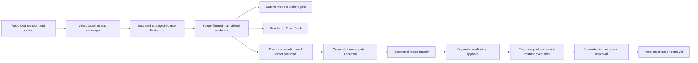

# Architecture and evidence

Mutant Review asks whether green tests detect a specific behavioral change. The shipping contract includes exactly 10,000 cents. The initial suite covers 9,999 and 10,001 cents. Real mutation execution shows whether replacing `>=` with `>` escapes those tests.

This diagram describes the intended complete workflow. See `limitations.md` for the implemented boundary; arrows do not establish execution evidence.

`packages/demo-domain` is original deterministic checkout logic. `packages/review-core` owns safe diff scope, normalized statuses, fingerprints, metrics, policy, strict commands, approval predicates, structural preflight, and deterministic lesson retrieval. `packages/cli` executes Vitest/Stryker and writes evidence. `packages/gitlab-adapter` restricts every upstream operation to the configured numeric project, validates current MR heads, maps current diff versions, and controls approved isolated repair commits. `apps/front-desk` reads evidence on the server and renders the review console. Credentials remain on the server; the public interface has no mutation endpoints or merge controls.

Pipeline artifacts are the GitLab evidence source. Repository files hold approved lessons. Local demo evidence is labeled local and includes a source-content hash because an implementation session can have uncommitted working files. Local execution, GitLab execution, human approval, Duo output, lesson reuse, and deployment are separate states.

The standard score is `(Killed + TimedOut) / (Killed + TimedOut + Survived + NoCoverage)`. Assertion kills remain visible separately. Invalid, pending, partial, stale, or failed-baseline runs cannot pass. Zero applicable mutants produces no score. Current diff scope independently filters incremental reports so cached out-of-scope mutants cannot raise the score.

For repair proof, the initial production mutation scope is retained even when the repair changes tests only. The exact missing assertion must pass on intended code, fail against the targeted mutant with an assertion failure, leave the full original suite green, and reproduce in a clean rerun. A better aggregate score or a timeout alone cannot establish repair.

The Duo flow is an interpretation boundary. Deterministic code keeps authorization, revision checks, patch restrictions, scoring, and gate decisions. The prepared flow cannot write files or commit; its deterministic lesson lookup feeds an eight-cycle bounded read-only triage component. Repository text never becomes approval. Its output remains advisory until parsed and verified.

No database, vector store, queue, or paid payment service is needed. The only persistence beyond GitLab artifacts and repository lessons is a trusted one-use approval journal outside the working checkout. The current file journal supports a single host; distributed execution requires a shared atomic implementation.
